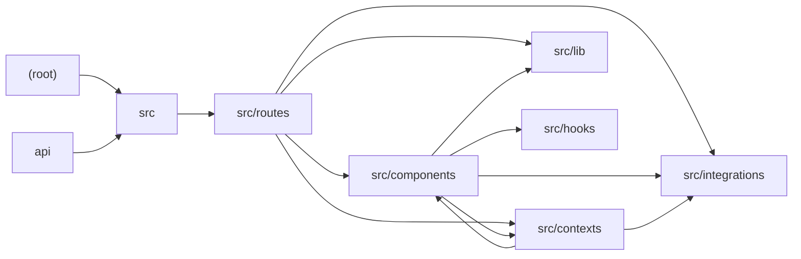

# Architecture

FC Sabbatår is a Danish-language football-team management app (seasons, squad, fixtures with lineups/events, attendance sign-up, fines ledger, iCalendar feed) built on TanStack Start + React Router with file-based routes, Tailwind, and a shadcn/ui-style Radix component library. All domain data lives in Supabase (Postgres via PostgREST); reads and writes are performed directly from the browser using the Supabase client, with authorization gated client-side by an AuthContext login dialog. Global state (auth session, selected season) is provided via React contexts wrapped around the route tree in __root.tsx. The only server-side code is a GET route handler that renders an .ics feed and a Node/Vercel-style adapter in api/ssr.js that bridges (req, res) to the compiled server's fetch handler. There are no AI touchpoints anywhere in the codebase. Notable risks: no route loaders (all fetching in useEffect, so SSR renders loading states), server-side enforcement of auth/deadlines depends on unseen RLS policies, and the api/ssr.js adapter sits outside the TanStack Start route conventions.

## Modules

| module | summary | AI |
| --- | --- | --- |
| `(root)` | ESLint flat config and Vite config wiring TanStack Start, React, Tailwind and tsconfig path aliases. | — |
| `api` | Node-style serverless adapter (api/ssr.js) that converts (req, res) into a WHATWG Request and streams the TanStack Start server's Response back. | — |
| `src` | Router factory (getRouter) built from the generated route tree with a default full-page error boundary. | — |
| `src/components` | Domain components (AttendancePanel, FixtureCalendar, SeasonPicker) plus a shadcn/ui-style Radix/cva/Tailwind primitive library under ui/. | — |
| `src/contexts` | AuthProvider (Supabase session + inline login dialog) and SeasonProvider (season list, localStorage-persisted selection, new-season dialog). | — |
| `src/hooks` | useIsMobile matchMedia hook for the 768px breakpoint. | — |
| `src/integrations` | Supabase layer: generated Database types plus browser/server client factories and an auth middleware. | — |
| `src/lib` | Pure utilities: formation presets/parsing, RFC 5545 iCalendar builder, and the cn() class-merge helper. | — |
| `src/routes` | File-based routes: root layout with nav/providers, home, stats, squad, fixtures list/detail, fines ledger, and a server GET handler serving the .ics season feed. | — |

## Module dependencies

_`[AI]` marks modules with AI/LLM touchpoints (prompt files, model API calls, agent logic)._
